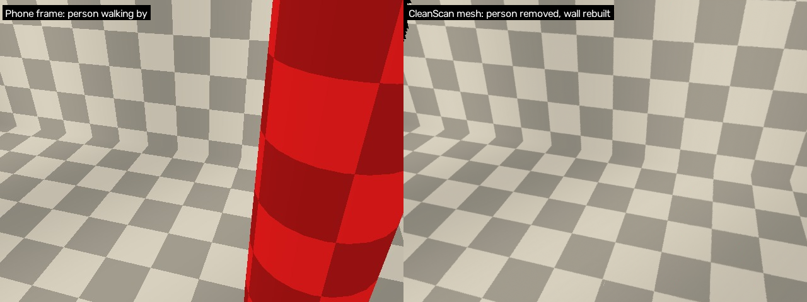

# CleanScan

A Scaniverse-style 3D scanner for **iPhone and Android** that **leaves people and animals
out of the scan**. The background they were standing in front of is rebuilt from other
moments of the scan. The result is exported as a ready-to-run **Gazebo world** plus a
**2D navigation map**.

```
 phone app (iOS / Android)                     desktop pipeline (Python)
 ┌───────────────────────────────┐            ┌─────────────────────────────────────────┐
 │ RGB + LiDAR/ToF depth + pose  │   .zip     │ 1. drop masked pixels (people/animals)  │
 │ people/animal masks per frame │ ─────────► │ 2. TSDF fusion  -> background filled    │
 │ live mesh preview             │  AirDrop / │    from frames where it was visible     │
 └───────────────────────────────┘  share     │ 3. ghost removal (missed movers)        │
                                              │ 4. cleanup, floor -> z=0, Z-up          │
                                              │ 5. photo texture (no people painted on) │
                                              │ 6. Gazebo model+world, Nav2 map         │
                                              └─────────────────────────────────────────┘
```



## How living beings are removed

Removal works in three layers, so that something missed by one layer is caught by the next:

1. **On-device segmentation, every frame.** On iPhone this uses ARKit people segmentation
   plus a YOLO-seg model covering people and 10 animal classes (bird, cat, dog, horse, sheep,
   cow, elephant, bear, zebra, giraffe). On Android it uses the same YOLO-seg model through
   TFLite. Masks are grown in depth on the desktop so hair, fur and edge pixels go too.
2. **Masked fusion.** Masked depth pixels never enter the TSDF volume. The wall behind a
   person is fused from the frames in which the person was somewhere else. This is a real
   reconstruction from those frames, not an AI guess.
3. **Ghost removal.** Every surface of a first-pass model is projected into every frame.
   Surfaces that later frames *see through* were transient (a person walking past, a pet, a
   door), so they are carved away and the scene is fused again (up to 3 rounds).
   `--resegment yolo11x-seg.pt` can also re-run a larger segmentation model on the desktop.

The texture is projected from the sharpest photos, and pixels that showed a person or
animal are skipped, so nobody gets "painted" onto the walls.

## Requirements

| | |
|---|---|
| iPhone / iPad | **LiDAR required**: iPhone 12 Pro or newer Pro / Pro Max, or iPad Pro 2020+. iOS 16+. |
| Android | Phone on the [ARCore Depth API list](https://developers.google.com/ar/devices). A ToF sensor gives much better results. Android 8+. |
| Desktop | Python 3.10–3.13, `pip install ./pipeline` (Open3D, OpenCV, NumPy). Linux, macOS or Windows. |
| Gazebo | Gazebo Harmonic/Ionic/Jetty (`gz sim`) **or** Gazebo Classic 11. |

## Quick start

### 1. Desktop pipeline

```bash
cd pipeline
python -m venv .venv && source .venv/bin/activate
pip install -e ".[dev]"          # add ,seg for desktop re-segmentation (ultralytics)
pytest -q                        # 5 end-to-end tests on a synthetic room

# try it without a phone: synthetic room + walking person + dog
cleanscan synth demo_session
cleanscan process demo_session -o demo_world
./demo_world/run_gazebo.sh        # or: ./demo_world/run_gazebo.sh classic
```

### 2. People/animal model for the apps

Ready-made models are already committed: `ios/Models/LivingSeg.mlpackage` and
`android/app/src/main/assets/living_seg.tflite` (YOLO11n-seg). To re-export them, for
example with a bigger model, run `python tools/export_models.py --help`. It lists the
tested torch/NumPy versions.

The Android detection path was checked end to end with the real model: the app's Kotlin
decoder, then the TFLite model, then the depth-resolution mask. Its masks match the
Ultralytics reference with an IoU of 0.94–0.98 on test photos of people and dogs
(`docs/android_mask_test.png`, `tools/verify_android_model.py`).

> **License:** Ultralytics YOLO models are AGPL-3.0. Publishing an app that bundles them
> requires AGPL compliance or an Ultralytics Enterprise license. Any YOLO-seg-style model
> trained on COCO classes (same output layout) can be swapped in.

Without the model, the iPhone app still removes people (ARKit) and cats/dogs (Apple Vision,
box-masked), and the Android app warns that it is not masking on the phone. Ghost removal
and `--resegment` on the desktop still work in both cases.

### 3. iPhone app

```bash
brew install xcodegen
cd ios && xcodegen               # creates CleanScan.xcodeproj
open CleanScan.xcodeproj         # set your Team under Signing, run on a LiDAR device
```

### 4. Android app

**Ready-to-install test build:** download
[CleanScan-debug.apk](https://github.com/srivatsa-dotcom/cleanscan/releases/download/android-latest/CleanScan-debug.apk)
from the [android-latest release](https://github.com/srivatsa-dotcom/cleanscan/releases/tag/android-latest).
GitHub Actions rebuilds it on every push that changes `android/` (`.github/workflows/android.yml`).

To build it yourself:

Open `android/` in Android Studio (Koala or newer) and press Run. Or, with the Android SDK
installed: `cd android && ./gradlew installDebug`.

### 5. Scan → Gazebo

1. Press **Record** and walk slowly through the space (see tips below), then press **Stop**.
2. Open **Scans** → **Export** to send the zip to your computer (AirDrop, Files, Drive, email…).
3. `cleanscan process Scan-20261022-101500.zip -o my_room --name my_room`
4. `./my_room/run_gazebo.sh`

Output:

```
my_room/
  models/my_room/model.sdf, model.config
  models/my_room/meshes/visual.obj + visual.mtl + visual_texture.png   (textured)
  models/my_room/meshes/collision.stl                                   (simplified)
  worlds/my_room.sdf      # Gazebo Sim (Harmonic/Ionic/Jetty)
  worlds/my_room.world    # Gazebo Classic 11
  maps/my_room.pgm + .yaml  # ROS 2 Nav2 / map_server occupancy grid, same frame as the world
  my_room_mesh.ply        # vertex-coloured mesh for MeshLab/Blender/CloudCompare
  run_gazebo.sh, report.json
```

The world frame is ROS-style (Z up, metres). The scanned floor is at
z = 0, and an invisible collision plane sits there so robots never fall through small
holes. The 2D map uses the same origin, so `map` and Gazebo `world` line up.

To spawn the scan inside your own world:
`<include><uri>model://my_room</uri></include>` with `GZ_SIM_RESOURCE_PATH`
(or `GAZEBO_MODEL_PATH`) pointing at `my_room/models`.

## Tips for a near-perfect scan

* **Let living beings move.** The background behind a person can only be rebuilt if some
  frame saw it without them. If someone stays put, scan that area again once they have
  moved. A surface that was never visible is left as an honest hole, never invented.
* Walk **slowly**, keep 0.5–3 m from surfaces, and sweep the **floor and the wall bottoms**.
  The floor is used for leveling and for the nav map.
* Close the loop: end the scan where you started, so ARKit/ARCore corrects drift.
* Even, bright light. Avoid mirrors, glass and black glossy surfaces (no depth returns).
* For large spaces, scan room by room. For fine detail, use `--voxel 0.01`
  (slower, about 4× more memory).

## CLI options (`cleanscan process --help`)

| option | default | |
|---|---|---|
| `--voxel` | 0.02 | TSDF voxel size (m). 0.01 = finer detail |
| `--max-depth` | 5.0 | ignore depth beyond this (m) |
| `--min-confidence` | from app | 0..1 depth confidence cut-off |
| `--mask-dilate` | 4 | grow people/animal masks (depth px) |
| `--resegment MODEL` | off | desktop YOLO-seg pass, e.g. `yolo11x-seg.pt` |
| `--no-ghost-removal` | | disable the see-through check |
| `--texture photo\|none` | photo | photo-projected texture atlas |
| `--texture-size` | 4096 | texture atlas resolution |
| `--hole-size` | 0.15 | close holes up to this size (m) |
| `--map-resolution` | 0.05 | nav map cell size (m) |
| `--robot-height` | 1.8 | obstacles up to this height go into the 2D map |
| `--no-center` | | keep the capture origin instead of centering the scan |

## Project layout

```
ios/        SwiftUI + ARKit + RealityKit app (XcodeGen project.yml)
android/    Kotlin + ARCore + TFLite app (Gradle)
pipeline/   Python package `cleanscan` + tests
tools/      model export + Android model/decoder verification (decoder-test/)
docs/       capture_format.md (the shared phone→desktop format)
```

## Known limitations

* Scan accuracy depends on the phone's depth sensor (iPhone LiDAR: about 1 cm at 1 m, usable
  to about 5 m) and on ARKit/ARCore drift over long scans. Scan big buildings in parts.
* A being that never moves is removed but leaves a hole where nothing behind it was seen.
* Animals outside the 10 COCO animal classes (for example reptiles or fish) are not segmented
  on the phone. Ghost removal still catches them if they move.
* Processing runs on a computer, not on the phone. A 3-minute scan takes several minutes on a
  laptop CPU.
