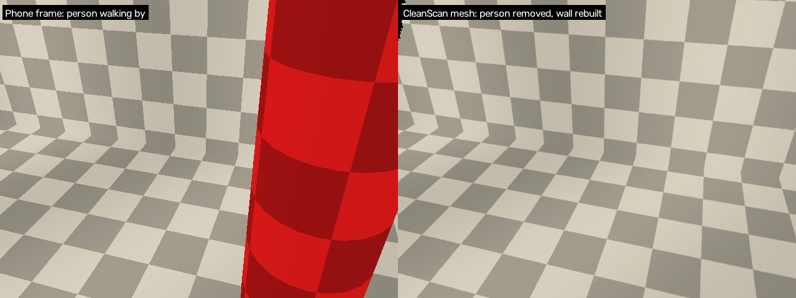
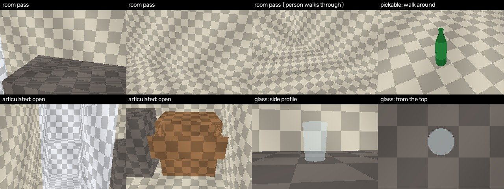
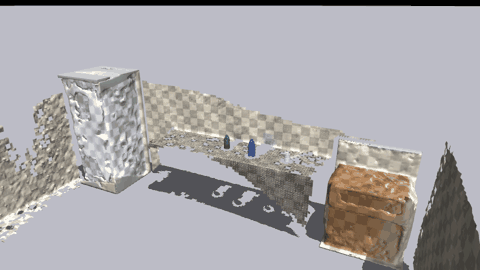

# CleanScan

A Scaniverse-style 3D scanner for **iPhone and Android** that **leaves people and animals
out of the scan**. The background they were standing in front of is rebuilt from other
moments of the scan. The result is exported as a ready-to-run **Gazebo world** plus a
**2D navigation map**.

```
 phone app (iOS / Android)                     desktop pipeline (Python)
 ┌───────────────────────────────┐            ┌─────────────────────────────────────────┐
 │ RGB + LiDAR/ToF depth + pose  │   .zip     │ 1. drop masked pixels (people/animals)  │
 │ people/animal masks per frame │ ─────────► │ 2. TSDF fusion  -> background filled    │
 │ live mesh preview             │  AirDrop / │    from frames where it was visible     │
 └───────────────────────────────┘  share     │ 3. ghost removal (missed movers)        │
                                              │ 4. cleanup, floor -> z=0, Z-up          │
                                              │ 5. photo texture (no people painted on) │
                                              │ 6. Gazebo model+world, Nav2 map         │
                                              └─────────────────────────────────────────┘
```



## Install in 5 minutes

Everything below comes from the rolling
[**latest** release](https://github.com/srivatsa-dotcom/cleanscan/releases/tag/latest), rebuilt by
GitHub Actions on every push to `main`.

| | |
|---|---|
| **iPhone** (iOS 16+, iPhone 11 or newer) | Download [CleanScan-unsigned.ipa](https://github.com/srivatsa-dotcom/cleanscan/releases/download/latest/CleanScan-unsigned.ipa), install it with [Sideloadly](https://sideloadly.io) and your Apple ID (Windows/macOS) or the Linux Sideloader CLI - steps in [iPhone app](#3-iphone-app). |
| **Android** (ARCore phone, Android 8+) | Download [CleanScan.apk](https://github.com/srivatsa-dotcom/cleanscan/releases/download/latest/CleanScan.apk) on the phone, allow "install unknown apps", open it. |
| **Desktop pipeline** (Python 3.10-3.13; Linux, macOS, Windows) | `git clone https://github.com/srivatsa-dotcom/cleanscan && pip install "./cleanscan/pipeline[sim,collision]"` (on Linux also `sudo apt install libegl1 libgl1`). `sim` adds MuJoCo + USD checks, `collision` better collision shapes. |
| **Depth module** (optional, for phones without LiDAR) | Build it from [module/README.md](module/README.md), then flash with one command: `cd module/firmware && pio run -t upload`, or download [cleanscan-depth-esp32s3-factory.bin](https://github.com/srivatsa-dotcom/cleanscan/releases/download/latest/cleanscan-depth-esp32s3-factory.bin) and run `esptool.py --chip esp32s3 write_flash 0x0 cleanscan-depth-esp32s3-factory.bin`. |

## Scan your kitchen for RL

CleanScan can turn a scan into a **simulation scene where a robot can open the fridge, pull out
drawers and pick up bottles and glasses**: one folder that loads in **Isaac Sim / Isaac Lab
(USD)**, **MuJoCo (MJCF)** and **Gazebo (SDF)**.



1. **Room pass.** Press Record and walk slowly through the kitchen, as for any scan. The app
   detects objects as you go (fridge, bottles, cups, ...).
2. **Choose the interactive objects.** After Stop the app lists what it found ("Found:
   refrigerator, 2× bottle, cup. Which should be interactive for RL?"). Tick the ones the robot
   should use and check their type: **Pick up**, **Opens** (doors, drawers) or **Glass**. Missed
   something (a cupboard, a pressure cooker)? *Add an object the phone missed*, tap it on a photo
   and type its name.
3. **Guided captures**, one per object, the app tells you what to do:
   * *Pick up*: put it on a free surface and walk around it until the ring is full;
   * *Opens*: scan it closed, open it fully, scan again;
   * *Glass*: hold the phone level beside it, then one shot from the top.
4. **Export** the scan (Scans → Export) and run on your computer:

   ```bash
   cleanscan process-rl Scan-XXXX.zip -o my_kitchen     # ~5-15 min on a laptop CPU
   cleanscan validate my_kitchen                          # 5 s MuJoCo check, also writes report.json
   ```



```
my_kitchen/
  scene.json        # objects: type, pose, mass, inertia, friction, joints (m, kg, Z up, floor z = 0)
  room/             # the static room: meshes, Gazebo model, Nav2 map, collision boxes
  objects/<id>/     # visual.obj + texture, collision/*.obj (convex pieces)
  export/scene.usda # Isaac Sim / Isaac Lab (UsdPhysics) + isaaclab_scene.py example config
  export/scene.xml  # MuJoCo
  export/world.sdf  # Gazebo Sim (world.world: Classic) + run_gazebo.sh
  report.json       # what was found, quality metrics, warnings, validation results
my_kitchen.zip
```

* **Change physics** (mass, friction, material, joint limits, object type) in `scene.json`
  under each object's `"overrides"`, then `cleanscan export my_kitchen`. Default masses come
  from `pipeline/cleanscan/data/materials.yaml` (class → material → density, hollow shells).
* **Try it without a phone:**
  `cleanscan synth-kitchen kitchen --depth-module a010 && cleanscan process-rl kitchen -o kitchen_scene`
  (a synthetic kitchen as an iPhone 11 with the clip-on depth module records it; the images above
  come from this run, rendered with `tools/render_readme.py`).
* **How it works and what to expect:** [docs/RL_SCENES_PLAN.md](docs/RL_SCENES_PLAN.md). On the
  synthetic kitchen the tests require (and get) hinge axes within 5°, hinge positions within
  3 cm, object positions within 2 cm and masses within 30 %. Real scans will be less accurate;
  `report.json` lists every assumption made (for example inferred drawer depth) as a warning.

## How living beings are removed

Removal works in three layers, so that something missed by one layer is caught by the next:

1. **On-device segmentation, every frame.** On iPhone this uses ARKit people segmentation
   plus a YOLO-seg model covering people and 10 animal classes (bird, cat, dog, horse, sheep,
   cow, elephant, bear, zebra, giraffe). On Android it uses the same YOLO-seg model through
   TFLite. Masks are grown in depth on the desktop so hair, fur and edge pixels go too.
2. **Masked fusion.** Masked depth pixels never enter the TSDF volume. The wall behind a
   person is fused from the frames in which the person was somewhere else. This is a real
   reconstruction from those frames, not an AI guess.
3. **Ghost removal.** Every surface of a first-pass model is projected into every frame.
   Surfaces that later frames *see through* were transient (a person walking past, a pet, a
   door), so they are carved away and the scene is fused again (up to 3 rounds).
   `--resegment yolo11x-seg.pt` can also re-run a larger segmentation model on the desktop.

The texture is projected from the sharpest photos, and pixels that showed a person or
animal are skipped, so nobody gets "painted" onto the walls.

## Requirements

| | |
|---|---|
| iPhone / iPad | iOS 16+. **Best:** LiDAR models (iPhone 12 Pro or newer Pro / Pro Max, iPad Pro 2020+). **Also works:** iPhones without LiDAR (e.g. iPhone 11, XR, SE 2nd gen+) in camera-only mode, with depth computed on the computer (less accurate). |
| Android | Phone on the [ARCore Depth API list](https://developers.google.com/ar/devices). A ToF sensor gives much better results. Android 8+. |
| Desktop | Python 3.10–3.13, `pip install ./pipeline` (Open3D, OpenCV, NumPy). Linux, macOS or Windows. |
| Gazebo | Gazebo Harmonic/Ionic/Jetty (`gz sim`) **or** Gazebo Classic 11. |

## Quick start

### 1. Desktop pipeline

```bash
cd pipeline
python -m venv .venv && source .venv/bin/activate
pip install -e ".[dev]"          # add ,seg for desktop re-segmentation (ultralytics, AGPL)
pytest -q                        # synthetic room + kitchen end-to-end tests (~8 min)

# try it without a phone: synthetic room + walking person + dog
cleanscan synth demo_session
cleanscan process demo_session -o demo_world
./demo_world/run_gazebo.sh        # or: ./demo_world/run_gazebo.sh classic
```

### 2. People/animal model for the apps

Ready-made models are already committed: `ios/Models/LivingSeg.mlpackage` and
`android/app/src/main/assets/living_seg.tflite` (YOLO11n-seg). To re-export them, for
example with a bigger model, run `python tools/export_models.py --help`. It lists the
tested torch/NumPy versions.

The Android detection path was checked end to end with the real model: the app's Kotlin
decoder, then the TFLite model, then the depth-resolution mask. Its masks match the
Ultralytics reference with an IoU of 0.94–0.98 on test photos of people and dogs
(`docs/android_mask_test.png`, `tools/verify_android_model.py`).

> **License:** Ultralytics YOLO models are AGPL-3.0. Publishing an app that bundles them
> requires AGPL compliance or an Ultralytics Enterprise license. Any YOLO-seg-style model
> trained on COCO classes (same output layout) can be swapped in by configuration (iOS
> `CleanScanSegModel` in `ios/project.yml`, Android `-Pcleanscan.segModel=...`); see
> [LICENSES.md](LICENSES.md).

Without the model, the iPhone app still removes people (ARKit) and cats/dogs (Apple Vision,
box-masked), and the Android app warns that it is not masking on the phone. Ghost removal
and `--resegment` on the desktop still work in both cases.

### 3. iPhone app

**Install the test build without a Mac:** GitHub builds an unsigned app on every push to `main`
(`.github/workflows/ios.yml`). Download
[CleanScan-unsigned.ipa](https://github.com/srivatsa-dotcom/cleanscan/releases/download/latest/CleanScan-unsigned.ipa)
from the [latest release](https://github.com/srivatsa-dotcom/cleanscan/releases/tag/latest)
(the older `ios-latest` release keeps being updated too), then sign and install it with your Apple ID:

1. On a Windows PC or a Mac, install [Sideloadly](https://sideloadly.io) (on Windows also
   iTunes and iCloud from Apple's website, not the Microsoft Store versions).
2. Connect the iPhone by USB and tap **Trust**. Open Sideloadly, drop in the `.ipa`, enter
   your Apple ID and press **Start**.
3. On the iPhone: Settings → General → VPN & Device Management → your Apple ID → **Trust**;
   then Settings → Privacy & Security → **Developer Mode** → on (restart when asked).
4. With a free Apple ID the app stops opening after 7 days; reinstall it the same way.

**On Linux (e.g. Ubuntu 22.04)**, use the Sideloader CLI instead of Sideloadly. This repo
builds it for x86_64 (`.github/workflows/sideloader.yml`):

```bash
sudo apt install -y usbmuxd libimobiledevice6 libimobiledevice-utils libplist3
wget https://github.com/srivatsa-dotcom/cleanscan/releases/download/sideloader-linux/sideloader-linux-x86_64
wget https://github.com/srivatsa-dotcom/cleanscan/releases/download/latest/CleanScan-unsigned.ipa
chmod +x sideloader-linux-x86_64
idevicepair pair                      # tap Trust on the iPhone, then run it again
./sideloader-linux-x86_64 install -i CleanScan-unsigned.ipa
```

**Camera-only mode (no LiDAR, e.g. iPhone 11).** The app records colour, ARKit poses and
people masks, and `cleanscan process` computes depth by multi-view stereo between frames,
in real metres from ARKit's poses. How to scan for it:

* **Walk sideways** along the walls with the phone facing them, about 1–2 m away. Turning
  on the spot gives the computer no depth.
* Plain white walls and glossy surfaces produce holes. Textured rooms work best.
* Expect a few centimetres of error, against about 1 cm with LiDAR. On a synthetic room the
  stereo depth had a median error of 1.6 cm; real scans will be worse.

**Build it yourself on a Mac:**

```bash
brew install xcodegen
cd ios && xcodegen               # creates CleanScan.xcodeproj
open CleanScan.xcodeproj         # set your Team under Signing, run on a LiDAR device
```

### 4. Android app

**Ready-to-install test build:** download
[CleanScan.apk](https://github.com/srivatsa-dotcom/cleanscan/releases/download/latest/CleanScan.apk)
from the [latest release](https://github.com/srivatsa-dotcom/cleanscan/releases/tag/latest).
GitHub Actions rebuilds it on every push to `main` (`.github/workflows/android.yml`; the older
`android-latest` release with `CleanScan-debug.apk` keeps being updated too). CI builds are
debug-signed unless a release keystore is set up as repository secrets (`ANDROID_KEYSTORE_B64`,
`ANDROID_KEYSTORE_PASSWORD`, `ANDROID_KEY_ALIAS`, `ANDROID_KEY_PASSWORD`); with debug signing,
uninstall the previous version before installing a newer one.

To build it yourself:

Open `android/` in Android Studio (Koala or newer) and press Run. Or, with the Android SDK
installed: `cd android && ./gradlew installDebug`.

### 5. Scan → Gazebo

1. Press **Record** and walk slowly through the space (see tips below), then press **Stop**.
2. Open **Scans** → **Export** to send the zip to your computer (AirDrop, Files, Drive, email…).
3. `cleanscan process Scan-20261022-101500.zip -o my_room --name my_room`
4. `./my_room/run_gazebo.sh`

Output:

```
my_room/
  models/my_room/model.sdf, model.config
  models/my_room/meshes/visual.obj + visual.mtl + visual_texture.png   (textured)
  models/my_room/meshes/collision.stl                                   (simplified)
  worlds/my_room.sdf      # Gazebo Sim (Harmonic/Ionic/Jetty)
  worlds/my_room.world    # Gazebo Classic 11
  maps/my_room.pgm + .yaml  # ROS 2 Nav2 / map_server occupancy grid, same frame as the world
  my_room_mesh.ply        # vertex-coloured mesh for MeshLab/Blender/CloudCompare
  run_gazebo.sh, report.json
```

The world frame is ROS-style (Z up, metres). The scanned floor is at
z = 0, and an invisible collision plane sits there so robots never fall through small
holes. The 2D map uses the same origin, so `map` and Gazebo `world` line up.

To spawn the scan inside your own world:
`<include><uri>model://my_room</uri></include>` with `GZ_SIM_RESOURCE_PATH`
(or `GAZEBO_MODEL_PATH`) pointing at `my_room/models`.

## No LiDAR phone? Add a depth module

The **clip-on depth module** (ESP32-S3 + MaixSense A010 ToF camera, about USD 40) streams depth
images to the app; it is the recommended add-on for RL scenes on an iPhone 11. Hardware,
wiring, flashing and scanning: [module/README.md](module/README.md).

## No LiDAR phone? Add one: the CleanScan rig

A Raspberry Pi Zero + an LD06/LD19 2D LiDAR (about ₹4,000 together) clipped to an iPhone 11
or any phone turns it into a LiDAR scanner: in simulation, 0.9 cm median error against
1.3 cm camera-only, with the LiDAR mount calibrated automatically. Parts, wiring, Pi setup
and scanning steps: [rig/README.md](rig/README.md).

## Tips for a near-perfect scan

* **Let living beings move.** The background behind a person can only be rebuilt if some
  frame saw it without them. If someone stays put, scan that area again once they have
  moved. A surface that was never visible is left as an honest hole, never invented.
* Walk **slowly**, keep 0.5–3 m from surfaces, and sweep the **floor and the wall bottoms**.
  The floor is used for leveling and for the nav map.
* Close the loop: end the scan where you started, so ARKit/ARCore corrects drift.
* Even, bright light. Avoid mirrors, glass and black glossy surfaces (no depth returns).
* For large spaces, scan room by room. For fine detail, use `--voxel 0.01`
  (slower, about 4× more memory).

## CLI options (`cleanscan process --help`)

| option | default | |
|---|---|---|
| `--voxel` | 0.02 | TSDF voxel size (m). 0.01 = finer detail |
| `--max-depth` | 5.0 | ignore depth beyond this (m) |
| `--min-confidence` | from app | 0..1 depth confidence cut-off |
| `--mask-dilate` | 4 | grow people/animal masks (depth px) |
| `--resegment MODEL` | off | desktop YOLO-seg pass, e.g. `yolo11x-seg.pt` |
| `--no-ghost-removal` | | disable the see-through check |
| `--texture photo\|none` | photo | photo-projected texture atlas |
| `--texture-size` | 4096 | texture atlas resolution |
| `--hole-size` | 0.15 | close holes up to this size (m) |
| `--map-resolution` | 0.05 | nav map cell size (m) |
| `--robot-height` | 1.8 | obstacles up to this height go into the 2D map |
| `--no-center` | | keep the capture origin instead of centering the scan |

## Project layout

```
ios/        SwiftUI + ARKit + RealityKit app (XcodeGen project.yml)
android/    Kotlin + ARCore + TFLite app (Gradle)
pipeline/   Python package `cleanscan` + tests (process, process-rl, validate, export, synth*)
rig/        Raspberry Pi bridge for an external LiDAR or an Arducam ToF depth module
module/     clip-on depth module: ESP32-S3 + A010 firmware, 3D-printable clip, parts list
tools/      model export + Android model/decoder verification (decoder-test/)
docs/       capture_format.md (the shared phone→desktop format), RL_SCENES_PLAN.md
```

## Known limitations

* Camera-only scans (iPhones without LiDAR) are less accurate and leave holes on texture-less
  surfaces; their depth is estimated by stereo, so the walking technique matters a lot.
* Scan accuracy depends on the phone's depth sensor (iPhone LiDAR: about 1 cm at 1 m, usable
  to about 5 m) and on ARKit/ARCore drift over long scans. Scan big buildings in parts.
* A being that never moves is removed but leaves a hole where nothing behind it was seen.
* Animals outside the 10 COCO animal classes (for example reptiles or fish) are not segmented
  on the phone. Ghost removal still catches them if they move.
* Processing runs on a computer, not on the phone. A 3-minute scan takes several minutes on a
  laptop CPU.

## License

Code: Apache-2.0 ([LICENSE](LICENSE)). Depth-module firmware: MIT. Depth-module hardware:
CERN-OHL-P-2.0. Third-party licences, and what to check before distributing the apps (the
bundled YOLO model is AGPL-3.0): [LICENSES.md](LICENSES.md).
